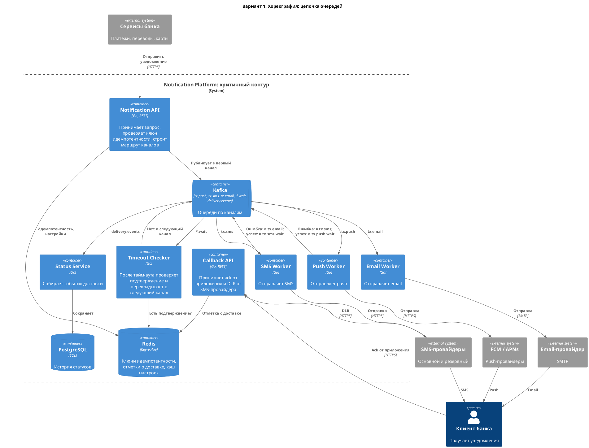
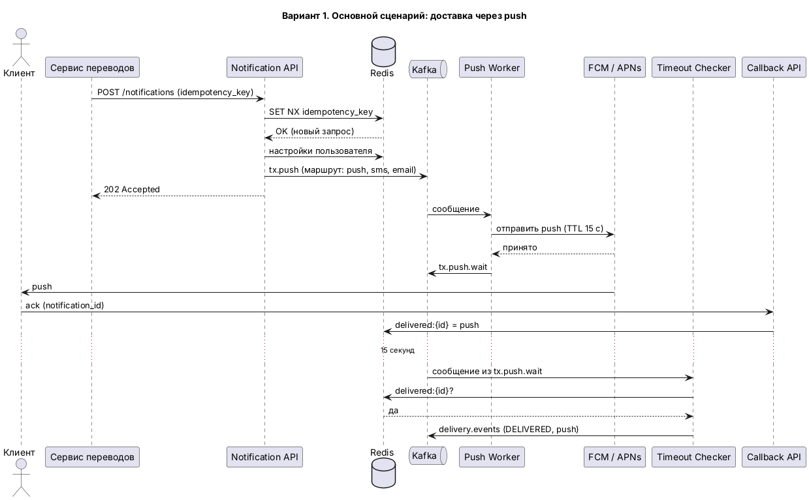
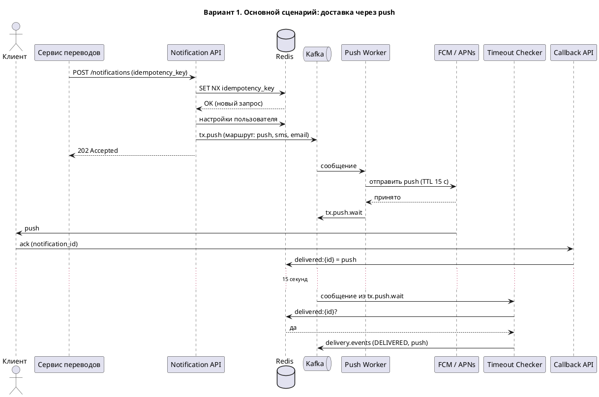
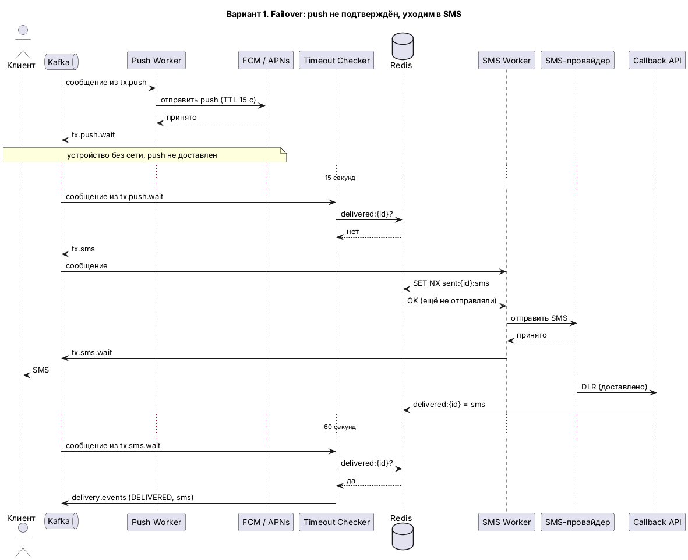
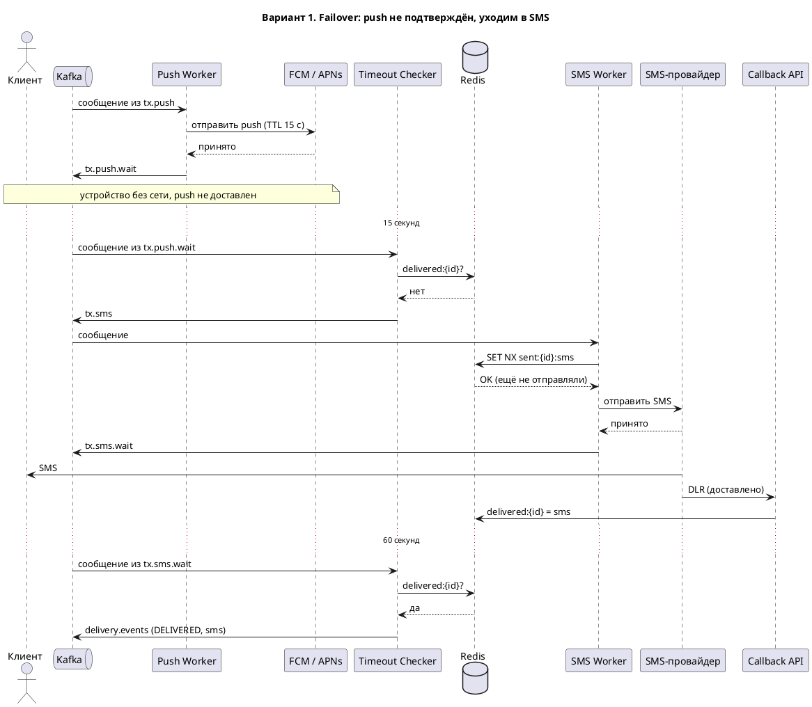
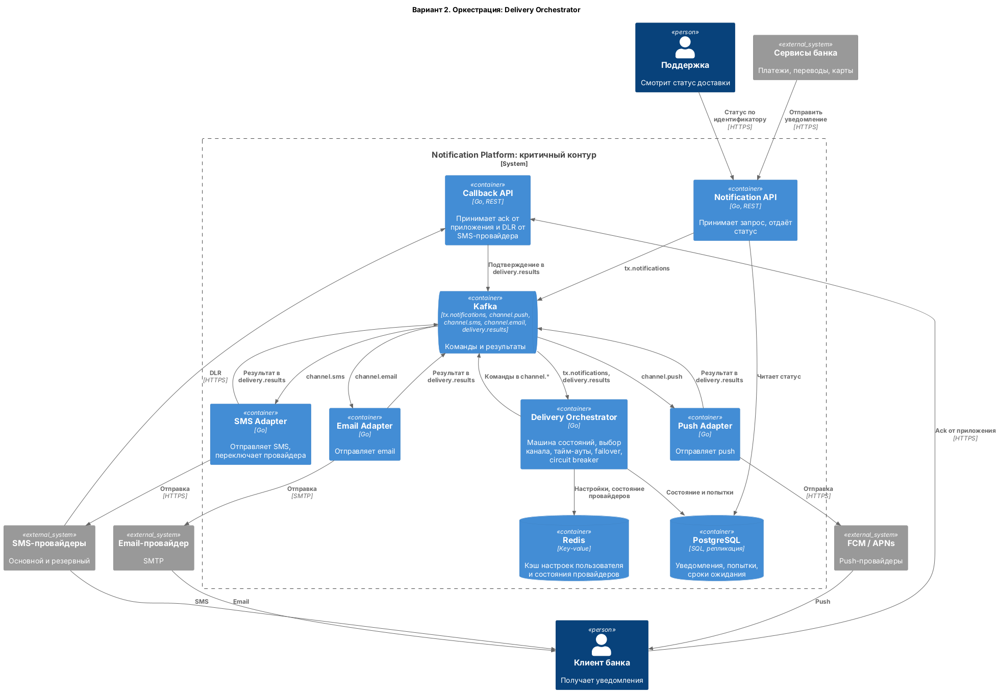
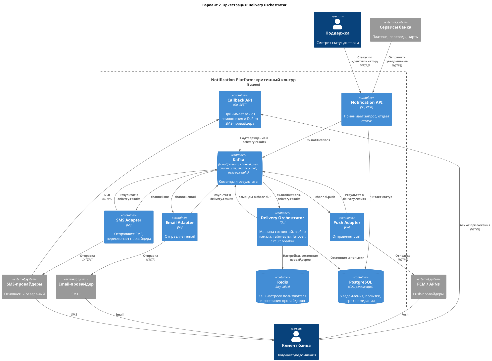
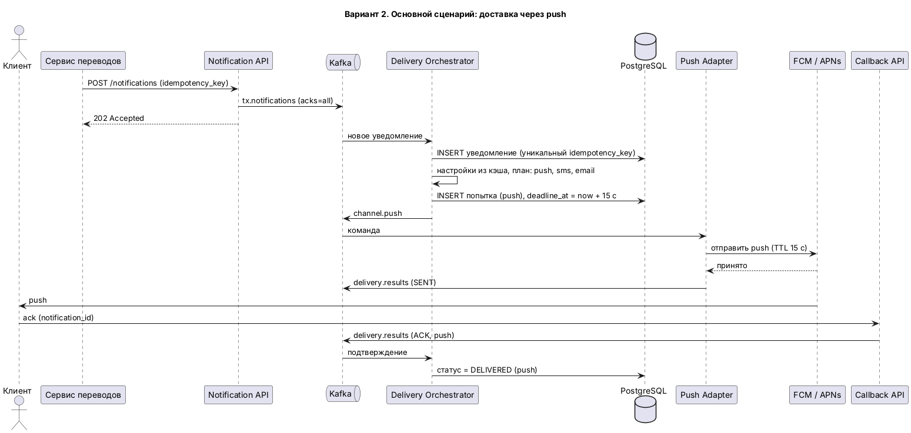
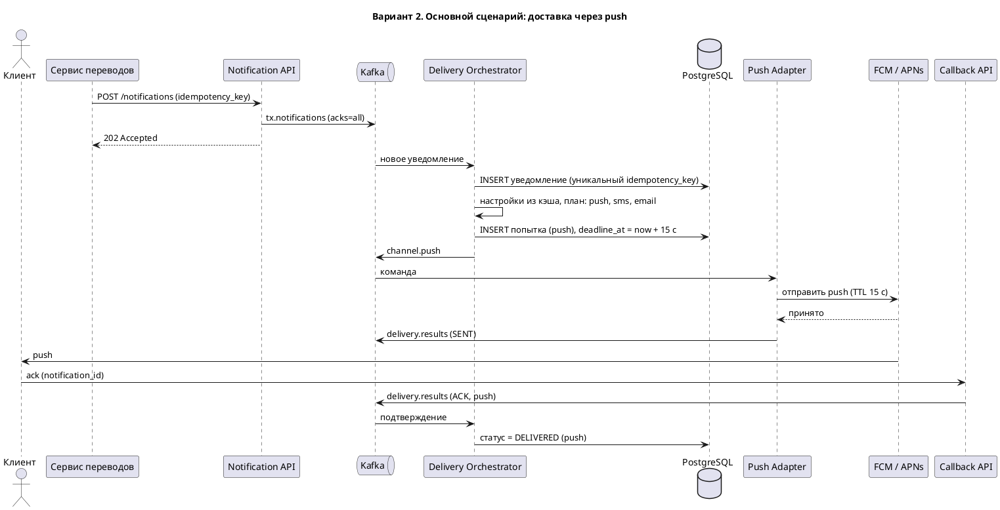
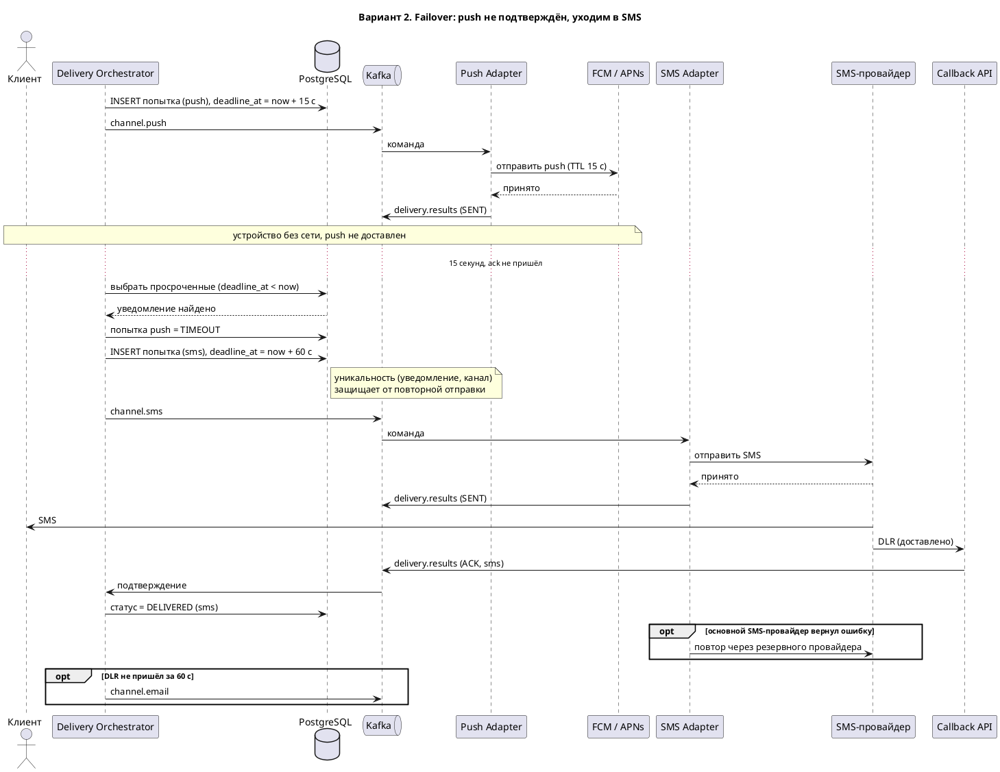

# RFC: Гарантированная доставка критичных уведомлений с кросс-канальным failover

| Метаданные | Значение |
|-----------|----------|
| **Статус** | DRAFT |
| **Автор** | Андрей Стюарт |
| **Ответственный** | Андрей Стюарт |
| **Бизнес-заказчик** | Владелец продукта Notification Platform |
| **Ревьюеры** | [Преподаватель курса] |
| **Дата создания** | 2026-11-17 |
| **Дата обновления** | 2026-11-17 |

---

## Оглавление

1. [Контекст](#контекст)
2. [Продуктовый анализ](#продуктовый-анализ)
3. [Пользовательские сценарии](#пользовательские-сценарии)
4. [Статистика](#статистика)
5. [Требования](#требования)
6. [Варианты решения](#варианты-решения)
7. [Сравнительный анализ](#сравнительный-анализ)
8. [Выводы](#выводы)
9. [Связанные задачи](#связанные-задачи)
10. [Приложения](#приложения)

---

## Контекст

Требования ко всей Notification Platform описаны в [dz4_zadaniya_1-7.md](dz4_zadaniya_1-7.md) (дальше просто «документ требований»). Здесь я беру из него одну подсистему: доставку транзакционных уведомлений. Это подтверждения переводов, списания, входы в аккаунт.

Сейчас каждая команда шлёт такие уведомления сама. Если провайдер в этот момент недоступен, уведомление теряется, потому что нет ни повтора, ни запасного канала. Для клиента это не просто неудобство. Он не узнаёт о списании и может пропустить мошенническую операцию.

Делать это первым стоит потому, что у этой подсистемы самые жёсткие требования. Если она получится, остальные типы уведомлений лягут на ту же инфраструктуру проще.

Кого касается: клиентов (10 млн MAU), команд, которые шлют уведомления (платежи, переводы, карты), поддержки (ей нужен статус доставки) и финансов (SMS стоят денег).

В RFC не входят сервисные и маркетинговые уведомления, шаблоны текстов и экран настроек.

---

## Продуктовый анализ

Из трёх бизнес-целей платформы этот RFC напрямую закрывает гарантированную доставку критичных уведомлений. На жалобы (−30%) влияет через то, что уведомления о деньгах перестают теряться и не дублируются при переключении каналов. На retention влияет косвенно: банку, который сразу сообщает о каждом движении денег, больше доверяют.

Главный вопрос продукта здесь в том, в каком порядке использовать каналы. У каждого свои плюсы и проблемы.

Push почти бесплатный и приходит за 1–3 секунды. Но сервер не знает, показался ли он на экране: FCM и APNs отвечают только «принял». Чтобы знать наверняка, приложение должно само прислать подтверждение (ack).

SMS доходит почти всегда и даёт отчёт о доставке (DLR) от оператора. Зато дорого: я считаю по 3 ₽ за сообщение, точную цену надо уточнять у закупок.

Email дешёвый, но подтверждения прочтения нет, только «почтовый сервер принял». И читают почту не сразу. Поэтому email идёт последним, как страховка.

Отсюда порядок по умолчанию: push, потом SMS, потом email.

По настройкам решил так. Транзакционные уведомления не отключаются. Клиент может выбрать SMS первым каналом, если не доверяет пушам. Если push-токена нет (приложение не стоит или уведомления запрещены в настройках телефона), push пропускаем сразу и не ждём 15 секунд впустую.

---

## Пользовательские сценарии

| Приоритет | Тип сценария | Действующее лицо | Сценарий |
|-----------|--------------|------------------|----------|
| MUST HAVE | Основной | Клиент | Перевёл деньги, через пару секунд пришёл push |
| MUST HAVE | Failover | Клиент | Был без интернета, push не дошёл, через 15 секунд пришла SMS |
| MUST HAVE | Failover | Клиент | Основной SMS-провайдер лежит, SMS ушла через резервного (или письмо на почту) |
| MUST HAVE | Интеграция | Сервис-отправитель | Отправил запрос один раз, про каналы и повторы не думает |
| MUST HAVE | Защита от дублей | Клиент | Сервис переводов повторил запрос по тайм-ауту, а уведомление всё равно одно |
| SHOULD HAVE | Настройки | Клиент | Выбрал SMS основным каналом |
| SHOULD HAVE | Поддержка | Оператор | Видит по номеру операции, когда и куда ушло уведомление |
| SHOULD HAVE | Эксплуатация | Дежурный | Получает алерт, когда провайдер деградирует и растёт доля SMS |
| COULD HAVE | Финансы | Аналитик | Видит расходы на SMS с разбивкой по причинам переключения |

---

## Статистика

Исходные цифры из задания: 10 млн MAU, 3 млн DAU, 300 000 одновременно в пик, 2 транзакционных уведомления на человека в день.

Чего в задании нет и что я принял сам (всё это надо проверить на пилоте):

- 90% пушей подтверждаются с первой попытки;
- пик в 10 раз выше среднего;
- сообщение со служебными полями около 1 КБ;
- SMS стоит 3 ₽.

---

## Требования

Я не переписываю требования заново, а уточняю требования из документа под эту подсистему. Чтобы не путаться, функциональные требования RFC помечены `FR-D` (D = delivery), рядом указано, какое требование платформы они раскрывают. Нефункциональные идут под теми же номерами, что в документе требований, но с цифрами для критичного контура.

### Функциональные требования

| № | Приоритет | Обозначение | Требование |
|---|-----------|-------------|------------|
| 1 | MUST HAVE | FR-D1 | Отправитель получает «принято» только после того, как уведомление надёжно сохранено (раскрывает FR1) |
| 2 | MUST HAVE | FR-D2 | Доставленным считается уведомление, по которому есть подтверждение: ack приложения, DLR по SMS или приём письма почтовым сервером (FR3) |
| 3 | MUST HAVE | FR-D3 | Нет подтверждения за отведённое время или канал вернул ошибку: переключаемся на следующий канал (FR3) |
| 4 | MUST HAVE | FR-D4 | Порядок каналов учитывает настройки клиента, транзакционные уведомления не отключаются (FR4) |
| 5 | MUST HAVE | FR-D5 | Повторный запрос с тем же ключом идемпотентности не создаёт новое уведомление; в каждый канал отправляем не больше одного раза (FR5) |
| 6 | MUST HAVE | FR-D6 | Начинаем с самого дешёвого доступного канала (FR2) |
| 7 | SHOULD HAVE | FR-D7 | По id уведомления видна вся история: попытки, каналы, время, причины переключения (FR7) |
| 8 | SHOULD HAVE | FR-D8 | Если провайдер массово сбоит, временно его не используем и сразу идём в следующий канал или к резервному провайдеру (FR3) |

### Нефункциональные требования

| № | Приоритет | Обозначение | Требование |
|---|-----------|-------------|------------|
| 1 | MUST HAVE | NFR1 | Задержка: без изменений, p95 ≤ 2 с, p99 ≤ 5 с до передачи провайдеру первого канала |
| 2 | MUST HAVE | NFR2 | Надёжность: 99,9% подтверждённо доставлены за 90 с, ноль потерь после «принято». Уточнение: 90 с складываются из тайм-аутов цепочки (см. параметры ниже) |
| 3 | MUST HAVE | NFR3 | Доступность приёма 99,95% |
| 4 | MUST HAVE | NFR4 | Для критичного контура: 1 000 RPS, с запасом до 5 000 RPS добавлением экземпляров. Рассылки идут по отдельному контуру и сюда не попадают |
| 5 | MUST HAVE | NFR5 | Дублей ≤ 0,01% |
| 6 | MUST HAVE | NFR6 | Статус виден через ≤ 5 с, алерт о деградации канала через ≤ 1 мин. Уточнение: отдельно алертим, если доля SMS за 10 минут выросла выше 25% |
| 7 | SHOULD HAVE | NFR7 | Через SMS уходит ≤ 15% транзакционных уведомлений |

### ASR и приоритеты

Беру ASR1–ASR4 из документа требований и добавляю один, специфичный для этой подсистемы:

- **ASR5. Минимальная стоимость доставки** (FR-D6, NFR7). На уровне всей платформы это было просто требованием, но для failover оно становится архитектурным. Оно запрещает самый простой способ гарантировать доставку (слать сразу во все каналы) и заставляет делать последовательную цепочку с тайм-аутами.

Приоритеты для этой подсистемы:

1. ASR1, гарантированная доставка
2. ASR3, без дублей
3. ASR2, задержка
4. ASR5, стоимость
5. ASR4, наблюдаемость

ASR3 поднят выше ASR2, потому что у нас запас по задержке огромный (2 секунды против десятков миллисекунд на обработку), а дубли клиенты замечают сразу.

Когда ASR1 и ASR3 конфликтуют, выигрывает доставка. Лишняя SMS неприятна, а потерянное уведомление о списании хуже.

### Расчёт нагрузок

Базовый поток посчитан в документе требований (п. 2): 6 млн транзакционных уведомлений в день, около 70 RPS в среднем и около 700 в пик. Здесь считаю то, что нужно именно для failover.

```
Верхняя граница пика
  все 300 000 одновременных пользователей совершают операцию за минуту:
  300 000 / 60 = 5 000 RPS  →  отсюда запас в NFR4

SMS при нормальной работе
  10% от 6 млн = 600 000 SMS в день
  ≈ 7 в секунду в среднем, ≈ 70 в пик

SMS, если пуш лёг целиком
  весь поток идёт в SMS: до 700 в секунду
  (это число надо согласовать с провайдером заранее)

Деньги (3 ₽ за SMS)
  схема с failover:   600 000 × 3 = 1,8 млн ₽ в день
  всё сразу в SMS:    6 млн × 3   = 18 млн ₽ в день
  разница в 10 раз, это и есть аргумент за цепочку

Сколько уведомлений одновременно «ждут» подтверждения
  700 RPS × 15 с ≈ 10 500 в пик (мелочь для любой БД)

Записи в БД (для варианта 2)
  примерно 4 записи на уведомление (создание, попытка, отправлено, итог)
  700 × 4 ≈ 2 800 записей в секунду в пик
  при 5 000 RPS будет 20 000, это уже предел одного PostgreSQL

Хранение
  6 млн × 1 КБ = 6 ГБ в день, за 90 дней ≈ 540 ГБ

Push-обработчики
  вызов FCM ~100 мс, 50 параллельных запросов на экземпляр
  ≈ 500 RPS на экземпляр, на пик хватит двух, ставим три
```

### Параметры failover

Одинаковые для обоих вариантов.

- Ждём ack по пушу 15 секунд. Обычно он приходит за 1–3 секунды, так что 15 с запасом. Честно говоря, цифра взята на глаз, её надо подобрать на пилоте.
- TTL пуша у провайдера тоже 15 секунд. Иначе может случиться так: телефон появился в сети через минуту, а ему прилетают и пуш, и уже отправленная SMS.
- DLR по SMS ждём 60 секунд.
- В худшем случае до email доходим за 15 + 60 = 75 секунд, это укладывается в 90 из NFR2.
- Circuit breaker: если у провайдера больше 50% ошибок за 30 секунд, выключаем его на минуту и сразу шлём в следующий канал без ожидания.

---

## Варианты решения

В обоих вариантах обработка асинхронная, через Kafka. Разница в том, кто решает, что пора переключать канал. В первом варианте это делают сами обработчики, передавая сообщение друг другу по цепочке. Во втором есть отдельный сервис, который ведёт каждое уведомление от начала до конца.

### Вариант 1: Хореография (цепочка очередей по каналам)

> **Описание:** На каждый канал свой топик в Kafka и свой обработчик. Не сработал канал, обработчик сам кладёт сообщение в топик следующего. Центрального состояния нет, маршрут и история едут внутри сообщения.

#### Архитектура

Notification API принимает запрос, проверяет ключ идемпотентности в Redis, достаёт настройки клиента и кладёт сообщение в топик первого канала (обычно `tx.push`). Push Worker отправляет пуш и перекладывает сообщение в `tx.push.wait`. Через 15 секунд Timeout Checker забирает его оттуда и смотрит в Redis, есть ли отметка о доставке. Есть, значит готово. Нет, кладёт в `tx.sms`. Дальше то же самое для SMS. Отметки о доставке ставит Callback API, когда приходит ack от приложения или DLR от оператора.

Отдельный Status Service читает события из всех топиков и складывает историю в PostgreSQL.

Задержка в «ждущих» топиках делается так: Timeout Checker читает сообщение, смотрит на время отправки и, если 15 секунд ещё не прошло, ставит чтение на паузу. Это рабочий, но неуклюжий приём, потому что на каждый тайм-аут нужен свой топик.

**Диаграмма C4 (Container):**


<details>
<summary>Исходник PlantUML (diagrams/v1_c4.puml)</summary>



</details>

**Sequence: основной сценарий**



<details>
<summary>Исходник PlantUML (diagrams/v1_seq_main.puml)</summary>



</details>

**Sequence: failover**



<details>
<summary>Исходник PlantUML (diagrams/v1_seq_failover.puml)</summary>



</details>

#### Технологии

Kafka на 3 брокерах с репликацией ×3. Redis Cluster для ключей идемпотентности и отметок о доставке (с TTL сутки). PostgreSQL только под историю. Сервисы на Go в Kubernetes. Для наблюдаемости обычный набор: Prometheus и Grafana, OpenTelemetry с Jaeger, ELK для логов.

#### Как выполняются ASR

ASR1 выполняется, но с оговоркой. Пока сообщение не обработано, оно лежит в Kafka и не потеряется. Слабое место в Redis: если он потеряет данные (рестарт без персистентности, переключение мастера с потерей последних записей), Timeout Checker не увидит отметку о доставке и отправит лишнюю SMS.

ASR2 выполняется лучше всего: на пути пуша нет базы, только API, Kafka и обработчик.

ASR3 держится на `SET NX` в Redis, и это та же проблема, что в ASR1. Пока Redis жив, всё хорошо. Потерял ключи, получили дубли.

ASR4 выполняется частично. Историю собирает Status Service из событий, она отстаёт и бывает неполной, если какой-то обработчик не отправил событие. Ответить «что с уведомлением прямо сейчас» сложно.

ASR5 выполняется: цепочка последовательная, SMS только после неудачи пуша.

#### Этапы реализации

| Этап | Описание | Планируемый срок | Ресурсы | Риски |
|------|----------|------------------|---------|-------|
| 1 | API, Kafka, Push Worker, ack в приложении | 4 недели | 2 backend, 1 mobile, 1 DevOps | Мобильный релиз проходит ревью в сторах, может съехать |
| 2 | SMS и Email Worker, Timeout Checker, цепочка | 4 недели | 2 backend | Отлаживать ждущие топики больно |
| 3 | Status Service, метрики, алерты, нагрузочные тесты | 3 недели | 1 backend, 1 DevOps, 1 QA | История доставки с дырами |

#### Преимущества

- Самая низкая задержка, базы на критичном пути нет.
- Нет центрального сервиса, падение которого останавливает всё.
- Каждый обработчик простой и масштабируется сам по себе.
- Инфраструктуры меньше.

#### Недостатки

- Логика failover размазана по обработчикам. Захотели поменять тайм-аут или порядок каналов, правим и выкатываем несколько сервисов.
- Нет единого состояния. На вопрос поддержки «что с уведомлением» отвечаем, собирая события по кусочкам.
- Каждый тайм-аут означает отдельный ждущий топик.
- Защита от дублей опирается на Redis, а это не то хранилище, которому стоит доверять такие вещи.
- Circuit breaker и резервного провайдера придётся делать в каждом обработчике.

---

### Вариант 2: Оркестрация (Delivery Orchestrator)

> **Описание:** Отдельный сервис ведёт каждое уведомление по машине состояний, хранит состояние в PostgreSQL и сам решает, когда и куда отправлять. Обработчики каналов становятся тупыми адаптерами: получили команду, отправили, вернули результат.

#### Архитектура

Машина состояний одного уведомления:

```
ACCEPTED → SENDING(push) → WAITING_ACK(push) → DELIVERED
                │                 │ тайм-аут 15 с
                │ ошибка          ▼
                └────────► SENDING(sms) → WAITING_ACK(sms) → DELIVERED
                                 │               │ тайм-аут 60 с
                                 │ ошибка        ▼
                                 └───────► SENDING(email) → DELIVERED
                                                 │ ошибка
                                                 ▼
                                               FAILED (алерт дежурному)
```

API кладёт запрос в Kafka и отвечает `202 Accepted`, только когда Kafka подтвердила запись на все реплики (`acks=all`). Оркестратор читает запрос, создаёт запись в PostgreSQL, строит план каналов по настройкам клиента (настройки в кэше Redis) и отправляет команду в топик адаптера. Адаптер вызывает провайдера и пишет результат в `delivery.results`. Туда же Callback API пишет ack и DLR. Оркестратор читает результаты и двигает состояние.

Несколько деталей, на которых всё держится:

1. **Тайм-ауты.** Отправляя команду, оркестратор записывает `deadline_at`. Раз в секунду фоновый процесс выбирает просроченные:
   `SELECT ... WHERE status = 'WAITING_ACK' AND deadline_at < now() FOR UPDATE SKIP LOCKED`.
   `SKIP LOCKED` нужен, чтобы три экземпляра оркестратора не схватили одно и то же уведомление.
2. **Дубли при приёме.** Уникальный индекс на `idempotency_key`. Второй такой же запрос просто не вставится.
3. **Дубли при failover.** Каждая попытка лежит строкой с уникальным индексом на пару (уведомление, канал). Команду в адаптер отправляем, только если строка вставилась. Отправить SMS дважды по одному уведомлению физически не получится.
4. **Circuit breaker** живёт в оркестраторе, один на всех. Счётчики ошибок по провайдерам лежат в Redis.
5. **Порядок событий.** Ключ партиции в Kafka это id уведомления, так что события одного уведомления не перемешаются.

**Диаграмма C4 (Container):**



<details>
<summary>Исходник PlantUML (diagrams/v2_c4.puml)</summary>



</details>

**Sequence: основной сценарий**



<details>
<summary>Исходник PlantUML (diagrams/v2_seq_main.puml)</summary>



</details>

**Sequence: failover**


<details>
<summary>Исходник PlantUML (diagrams/v2_seq_failover.puml)</summary>



</details>

#### Технологии

- **Kafka**, 3 брокера в трёх зонах, репликация ×3, `acks=all`, по 12 партиций на топик.
- **PostgreSQL**: primary и синхронная реплика в другой зоне. Таблицы партиционированы по дням, старые партиции через 90 дней удаляются целиком (это быстрее, чем `DELETE`).
- **Redis** только как кэш: настройки клиентов и состояние провайдеров. Если он пропадёт, станет медленнее, но ничего не сломается.
- **Go + Kubernetes**, минимум 3 экземпляра каждого сервиса.
- **Prometheus, Grafana, Alertmanager** для метрик. **OpenTelemetry + Jaeger**, где trace_id совпадает с id уведомления. **ELK** для логов.

Что смотрим на дашборде: p95/p99 доставки по каналам, долю доставленных за 90 с, долю переключений с разбивкой по причинам, долю SMS и деньги, ошибки по провайдерам, число FAILED, lag консьюмеров Kafka.

#### Как выполняются ASR

ASR1. Приём с `acks=all`, состояние в PostgreSQL с синхронной репликой, тайм-ауты через `deadline_at`, три канала и запасной SMS-провайдер. Если не сработало вообще ничего, уведомление получает статус FAILED и дежурный получает алерт. Выполняется полностью.

ASR3. Уникальные индексы в PostgreSQL на приём и на каждую пару «уведомление + канал», плюс TTL пуша равен тайм-ауту. Это надёжнее Redis, потому что база не «забывает» закоммиченные данные.

ASR2. На пути до провайдера две записи в Kafka и одна транзакция в базе. По моей оценке это 50–100 мс, что далеко от 2 секунд. Рассылки идут через другие топики и других потребителей, так что сюда не влезут.

ASR5. Порядок каналов и тайм-ауты заданы в одном месте, их легко подкрутить, если доля SMS начнёт расти.

ASR4. Всё состояние в одной базе, статус виден сразу после коммита. «Сколько денег ушло на SMS из-за сбоя FCM вчера» считается одним SQL-запросом.

#### Этапы реализации

| Этап | Описание | Планируемый срок | Ресурсы | Риски |
|------|----------|------------------|---------|-------|
| 1 | API, Kafka, оркестратор, Push Adapter, ack в приложении | 5 недель | 2 backend, 1 mobile, 1 DevOps | Ревью в сторах |
| 2 | SMS и Email Adapter, тайм-ауты, failover, резервный SMS, circuit breaker | 4 недели | 2 backend | Баги в переходах состояний (нужны хорошие тесты на машину состояний) |
| 3 | Метрики, трейсинг, алерты, API статуса для поддержки | 2 недели | 1 backend, 1 DevOps | Особых нет |
| 4 | Нагрузочные и chaos-тесты, пилот на 5%, подбор тайм-аутов | 3 недели | 1 backend, 1 QA, 1 DevOps | Пуш дойдёт хуже, чем 90%, и придётся пересчитывать бюджет на SMS |

#### Преимущества

- Вся логика переключения в одном сервисе.
- Защиту от дублей обеспечивает база через транзакции и уникальные индексы.
- История каждого уведомления есть сразу, поддержке и финансам ничего собирать не надо.
- Адаптеры простые, новый канал (например, мессенджер) добавляется без изменений в остальных.
- Circuit breaker и настройки клиента реализуются один раз.

#### Недостатки

- Оркестратор и PostgreSQL становятся критичными. Нужно несколько экземпляров и реплика.
- Запись в базу на каждом шаге, плюс 10–20 мс.
- Около 5 000 RPS упрёмся в один PostgreSQL, дальше шардирование по id уведомления.
- На старте больше работы из-за машины состояний.

---

## Сравнительный анализ

### Ресурсные требования

| Критерий | Вариант 1. Хореография | Вариант 2. Оркестрация |
|----------|------------------------|------------------------|
| Время реализации | 11 недель | 14 недель |
| Команда | 2 backend, 1 mobile, 1 DevOps, 1 QA | Та же |
| Инфраструктура | Kafka, Redis Cluster (критичный), PostgreSQL под историю | Kafka, PostgreSQL с репликой (критичный), Redis как кэш |
| Организационные риски | Правила failover размазаны, при изменениях трогаем несколько сервисов и команд | Оркестратор становится центральным, нужен понятный владелец |

### Соответствие требованиям

| Требование | Вариант 1 | Вариант 2 |
|------------|-----------|-----------|
| FR-D1. Надёжный приём | ✅ Да | ✅ Да |
| FR-D2. Подтверждённая доставка | ✅ Да | ✅ Да |
| FR-D3. Автоматический failover | ✅ Да | ✅ Да |
| FR-D4. Настройки клиента | ✅ Да | ✅ Да |
| FR-D5. Без дублей | ⚠️ Пока жив Redis | ✅ Да |
| FR-D6. Сначала дешёвый канал | ✅ Да | ✅ Да |
| FR-D7. История доставки | ⚠️ С задержкой, бывает неполной | ✅ Да |
| FR-D8. Отключение сбойного провайдера | ⚠️ В каждом обработчике отдельно | ✅ Да |
| NFR1. p95 ≤ 2 с | ✅ Да | ✅ Да |
| NFR2. 99,9% за 90 с | ⚠️ Риск лишних SMS при сбое Redis | ✅ Да |
| NFR3. 99,95% | ✅ Да | ✅ При реплике БД |
| NFR4. 1 000 → 5 000 RPS | ✅ Да | ✅ Выше 5 000 нужно шардирование |
| NFR5. Дубли ≤ 0,01% | ⚠️ Пока жив Redis | ✅ Да |
| NFR6. Наблюдаемость | ⚠️ Частично | ✅ Да |
| NFR7. SMS ≤ 15% | ✅ Да | ✅ Да |

Если коротко про trade-off: вариант 1 выигрывает в задержке, в потолке масштабирования и в отсутствии центральной точки отказа. Вариант 2 выигрывает в надёжности состояния, защите от дублей, наблюдаемости и в том, как легко менять правила.

---

## Выводы

> **Рекомендация:** вариант 2, оркестрация.

**Обоснование выбора**

Два самых приоритетных ASR, доставка и отсутствие дублей, упираются в одно: где хранится состояние и можно ли ему верить. В варианте 2 это PostgreSQL с транзакциями. В варианте 1 Redis, и при сбое Redis мы получаем либо дубли, либо лишние SMS.

Главный плюс варианта 1, низкая задержка, нам почти ничего не даёт. Он экономит 10–20 мс, а у нас бюджет 2 секунды. По нагрузке PostgreSQL тоже справляется: в пик 2 800 записей в секунду.

Кроме того, тайм-ауты и порядок каналов почти наверняка придётся менять после пилота. В варианте 2 это правка одного сервиса, в варианте 1 нескольких.

За это платим тремя неделями разработки и тем, что база становится критичной. Для уведомлений о деньгах я считаю это нормальной ценой.

**На какие компромиссы идём**

Выбираем доставку хотя бы один раз (at-least-once), а не ровно один раз. Пример, когда будет дубль: пуш дошёл на 14-й секунде, но телефон тут же потерял сеть и ack не отправил. Через секунду уйдёт SMS. Клиент получит два сообщения. Это редкий случай, и он лучше, чем потерянное уведомление.

Сначала push, потом SMS. Значит, у клиента без интернета SMS придёт на 15 секунд позже, чем могла бы. Это цена экономии в 10 раз.

Центральный оркестратор вместо распределённой логики. Значит, его и базу надо резервировать.

**Ограничения и известные проблемы**

Про «гарантированную доставку» надо говорить честно. Если телефон выключен, а почту клиент не читает, мы сделаем все попытки, письмо примет почтовый сервер, и на этом всё. Гарантия означает, что мы попробовали все каналы и зафиксировали результат, а при полной неудаче поставили FAILED и подняли алерт.

Дальше несколько вещей, которые точно вылезут на практике.

- **Телефоны Huawei без Google-сервисов.** На них FCM не работает. Если не подключить HMS Push Kit, пуш будет уходить в никуда, и мы каждый раз будем ждать 15 секунд, а потом платить за SMS. Минимум, что надо сделать: хранить тип токена и для таких устройств без поддержки HMS сразу слать SMS.
- **Уведомления запрещены в настройках телефона.** На Android 13+ FCM вполне может принять сообщение, приложение его получит и даже отправит ack, но на экране ничего не появится. Мы будем считать уведомление доставленным, а клиент его не увидит. Поэтому приложение должно сообщать серверу, разрешены ли уведомления, и при запрете мы пропускаем push.
- **На iOS ack отправляет Notification Service Extension.** При плохой сети он не всегда успевает, и мы получим пуш и SMS одновременно. Это даст основную часть дублей, их долю надо смотреть на пилоте.
- **Старые версии приложения без ack.** Пока все не обновятся, каждое уведомление таким клиентам будет считаться недоставленным и дублироваться SMS. Доля SMS в первые месяцы будет выше 15%. Вариант: выпускать фичу постепенно и не включать failover по тайм-ауту для версий без ack (для них шлём SMS только при явной ошибке FCM).
- **Переключение PostgreSQL на реплику занимает 10–30 секунд.** Всё это время оркестратор стоит. Сообщения копятся в Kafka и не теряются, но p99 в эти секунды будет нарушен.
- **Деплой и ребалансировка консьюмеров Kafka** тоже дают паузу в несколько секунд. Помогает cooperative rebalancing и static membership, но совсем без пауз не получится.
- **DLR от некоторых операторов приходит поздно или вообще не приходит** (особенно в роуминге). Тогда через 60 секунд уйдёт ещё и письмо. Это не страшно, письмо дешёвое, но клиент получит два сообщения.
- **Полный отказ FCM** отправит в SMS до 700 сообщений в секунду и примерно 18 млн ₽ в день. Нужен дневной лимит бюджета с алертом и заранее согласованная с провайдером пропускная способность.
- **Сменился номер телефона.** Если клиент отдал старый номер оператору, а в банке его не обновил, SMS о списании уйдёт чужому человеку. Это не решается архитектурой этой подсистемы, но про это надо помнить.
- Выше примерно 5 000 RPS один PostgreSQL не вытянет, понадобится шардирование.

До начала разработки надо проверить три вещи: реальную долю доставки пушей и время ack (пилот на 5%), лимиты SMS-провайдеров (нагрузочный тест) и поведение при отказе провайдера (chaos-тест на стенде).

---

## Связанные задачи

- NP-1. Ack о получении пуша в iOS и Android, плюс передача статуса разрешения уведомлений.
- NP-2. Поддержка HMS Push Kit для устройств Huawei.
- NP-3. Резервный SMS-провайдер, согласование лимитов.
- NP-4. Kafka и PostgreSQL для критичного контура в трёх зонах.
- NP-5. Delivery Orchestrator и адаптеры каналов.
- NP-6. Дашборды, алерты, лимит бюджета на SMS, API статуса для поддержки.
- NP-7. Нагрузочные и chaos-тесты, пилот на 5%.
- NP-8. Перевод команд-отправителей на Notification API.

---

## Приложения

### Глоссарий

| Термин | Определение |
|--------|-------------|
| Транзакционное уведомление | Уведомление об операции с деньгами или о безопасности, отключить нельзя |
| Failover | Автоматическое переключение на запасной канал, если основной не сработал |
| ASR | Architecturally Significant Requirement, требование, которое заметно влияет на архитектуру |
| Ack | Подтверждение от приложения, что пуш получен |
| DLR | Delivery Report, отчёт оператора о доставке SMS |
| Ключ идемпотентности | Id запроса, по которому повторный запрос узнаётся и не создаёт новое уведомление |
| At-least-once | Доставка хотя бы один раз, редкие повторы допускаются |
| Оркестрация | Процессом управляет один сервис |
| Хореография | Сервисы передают работу друг другу без центрального управления |
| Circuit breaker | Временное отключение провайдера, который сыплет ошибками |
| TTL | Сколько живёт сообщение, после этого оно не доставляется |
| p95 / p99 | Время, в которое укладываются 95% / 99% запросов |
| RPS | Запросов в секунду |
